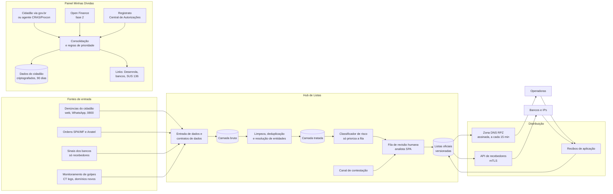

# Saída Segura: uma plataforma de dados para fechar o caminho do dinheiro das apostas ilegais e abrir o caminho de saída das dívidas

## Integrantes

| Nome completo | GitHub | Área de carreira | RGM |
|---|---|---|---|
| Valter Geronimo da Silva Junior | Valtergsj | Engenharia de Dados (Hub de Listas) | 47807458 |
| Gabriell Dos Santos Turuda Barbosa | gabriellturuda02-jpg | Engenharia de Dados (Painel de Dívidas) | 47964901 |
| Cauã Martins Aziago | cauaaziago20-creator | Engenharia de Dados (Painel de Dívidas) | 48100170 |
| Gabriel Plácido da Silva| placidogabriel788-glitch | Cibersegurança | 47770511 |

**Dossiê:** 3 — Endividamento e o fim das apostas online

**Recorte:** ex-apostadores e seus familiares com renda de até 5 salários mínimos, na **etapa pós-proibição** (a partir da MP nº 1.394/2026). A solução cobre dois momentos dessa etapa: (1) impedir que essas pessoas caiam no mercado ilegal e nos golpes que surgiram com o fim das apostas, atacando o lado de **quem recebe o dinheiro** (domínios e recebedores de Pix), e (2) dar a elas uma visão consolidada das próprias dívidas, com caminho para renegociar e para pedir ajuda em saúde mental.

*Por que este recorte:* a faixa de até 5 salários mínimos é a mesma do Novo Desenrola Brasil – Famílias (MP nº 1.355/2026), o que permite ligar a solução a um programa público que já existe. E a etapa pós-proibição é onde o problema mudou de forma: o mercado regulado acabou, mas o ilegal e os golpes cresceram. Esse é o ponto em que a Engenharia de Dados, área central do grupo, faz mais diferença, porque o gargalo hoje é **mover listas e dados entre governo, bancos e operadoras com rapidez e confiança**.

---

## 1. Análise do problema

### 1.1 Quem é afetado, onde e quanto

**As famílias estão no maior nível de endividamento já medido.** A Peic/CNC registrou 82% das famílias com dívidas a vencer em julho de 2026, cerca de 60 milhões de lares, sexto recorde consecutivo. O cartão de crédito aparece em 85,3% dos casos. Em setembro houve o primeiro recuo do ano, puxado pelas famílias de menor renda, mas o tempo médio de atraso chegou ao maior nível desde novembro de 2024. Entre as famílias com renda de até três salários mínimos, o endividamento chegou a 84,6%.

**As apostas tiraram renda das famílias em escala nacional.** Em 2025, as famílias perderam R$ 62,5 bilhões líquidos para as bets, o equivalente a 0,68% da Renda Nacional Disponível Bruta das Famílias, e as empresas de apostas movimentaram R$ 350,97 bilhões via Pix no ano. Mais de 25 milhões de pessoas apostaram em plataformas legalizadas em 2025, segundo a SPA/MF citada pelo Ministério da Saúde.

**A compulsão é um problema de saúde que cresce.** Os atendimentos na atenção primária do SUS por mania de jogos de apostas e transtorno do jogo passaram de 194 em 2018 para 5.007 em 2025; na atenção especializada, de 85 para 1.592. O teleatendimento do Meu SUS Digital, aberto em março de 2026, teve 6.912 cadastros em três meses.

**A proibição mudou o problema, mas não o eliminou.** A MP nº 1.394, de 25/09/2026, proibiu a exploração, a oferta, a intermediação e a publicidade das apostas de quota fixa, cancelou as 85 licenças do setor e tirou os sites do ar a partir de 6 de outubro. Os números da transição mostram o tamanho do que ficou para trás:

| O que | Número | Fonte |
|---|---|---|
| Saldo ainda a resgatar em 02/10/2026 | R$ 1,453 bilhão, distribuído entre 28,65 milhões de CPFs | Ministério da Fazenda (via ABCdoABC) |
| Sites encaminhados para bloqueio desde a MP (até 09/10/2026) | 16.627 | Governo federal (via Band) |
| Pedidos de bloqueio do Ministério da Fazenda desde dez/2024 | mais de 78 mil | Anatel e Senasp (via Teletime) |
| Novos sites ilegais identificados entre 22 e 28/09/2026 | 6.401 (média de 914 por dia) | ANJL (via Sigma World) |
| Queda no número de transações Pix desde a MP | 10% | Anatel e Senasp (via Teletime) |

**Os golpes passaram a explorar o próprio fim das apostas.** Surgiram páginas que imitam o portal do governo e cobram taxa via Pix para "liberar" saldo de bets, páginas falsas que coletam CPF de apostadores, embora a devolução oficial seja automática pelos bancos, e falsas casas de aposta que prometem até R$ 3 mil a partir de um Pix de R$ 20 e depois travam o saque.

**Onde.** O problema é nacional. O perfil mais atingido pelos problemas com jogo inclui pessoas negras, de baixa renda, moradoras de regiões metropolitanas e do Nordeste, segundo dados do INPAD apresentados pelo Ministério da Saúde ao Senado. Por isso o piloto (seção 6.2) prevê uma capital do Nordeste.

**Quem é afetado, em resumo:** ex-apostadores e famílias (renda, dívida, saúde mental); quem ainda aposta escondido em sites ilegais (sem nenhuma proteção); bancos e instituições de pagamento (passaram a ter obrigações e responsabilidade tributária solidária quando movimentam recursos de bets ilegais); operadoras de telecomunicações (executam os bloqueios); o governo (fiscalização, SUS, Desenrola).

### 1.2 Causas

**Causas tecnológicas (foco da proposta):**

1. **Domínio novo é mais rápido que bloqueio.** Registrar um domínio leva minutos; o fluxo atual (Fazenda identifica → Anatel ordena → cada operadora aplica) leva dias. A própria associação do setor (ANJL) apontou que novos endereços surgem minutos depois de cada derrubada. Até 29/09, só 2.387 dos 5.209 domínios pedidos já tinham ordem de bloqueio.
2. **As listas não são um produto de dados.** Os bloqueios circulam como ofícios e planilhas, sem formato padronizado, sem versionamento, sem histórico de quem incluiu o quê e por quê, e sem confirmação de que cada operadora ou banco aplicou a versão mais recente. Não há um "contrato de dados" entre quem produz a lista e quem a consome.
3. **O dinheiro passa por recebedores trocáveis.** Quase todo o fluxo das apostas foi via Pix. No mercado ilegal, o recebimento passa por contas de terceiros e intermediários que mudam com frequência. Cada banco enxerga só os próprios clientes; um recebedor bloqueado num banco reaparece em outro.
4. **Bloqueio por DNS tem limites técnicos conhecidos.** Ele é contornado por VPN, DNS alternativo (inclusive DNS sobre HTTPS no navegador) e troca constante de endereço. Bloqueio por IP derruba sites legítimos que dividem o mesmo servidor ou CDN.
5. **Golpes usam marca e urgência.** Sites falsos copiam a identidade visual do governo e das marcas extintas e são distribuídos por redes sociais e mensageiros. Certificados TLS gratuitos e hospedagem barata fazem o site parecer confiável.
6. **A dívida está espalhada em vários sistemas.** O cidadão tem cartão num banco, crédito pessoal em outro e um app de crédito numa fintech. O Registrato (SCR) mostra parte disso, mas atualiza mensalmente e exige conta gov.br prata ou ouro. O Open Finance já soma mais de 250 milhões de consentimentos, mas é usado principalmente para vender produtos, não para o cidadão enxergar o próprio quadro.
7. **Apps de crédito projetados para o "sim".** Aprovação em segundos e parcelamento sem custo efetivo total visível são decisões de produto que empurram a pessoa a contratar por impulso.

**Causas não tecnológicas:** publicidade clandestina por influenciadores; juros altos do rotativo; falta, há muitos anos, de uma rede de cuidado para quem tem compulsão; insegurança jurídica (a MP ainda precisa ser votada e é contestada no STF).

### 1.3 O que já existe e por que não basta

| Iniciativa | O que faz | Por que não basta |
|---|---|---|
| Bloqueio de sites pela Anatel a pedido da SPA/MF | Ordena às operadoras o bloqueio de domínios | Fluxo lento diante de ~900 novos sites/dia; sem padrão de dados nem confirmação de aplicação |
| Decreto de jun/2026 e Portaria MF nº 1.766/2026 | Bloqueio de recursos de bets ilegais e responsabilidade tributária solidária das instituições financeiras | Cria a obrigação, mas não a infraestrutura de dados para os bancos saberem, a tempo, quais recebedores bloquear |
| Plataforma Centralizada de Autoexclusão (dez/2025) | O apostador bloqueia o próprio acesso a sites **autorizados** | Com a proibição, não há mais sites autorizados; não alcança o mercado ilegal |
| Registrato (Banco Central) | Extrato gratuito de empréstimos e contas | Atualização mensal; não calcula prioridade nem conecta à renegociação; barreira do gov.br prata/ouro |
| Novo Desenrola Brasil – Famílias (MP nº 1.355/2026) | Descontos de até 90%, juros reduzidos e uso do FGTS para dívidas em atraso | O cidadão precisa ir a cada banco separadamente; não há visão única de quais dívidas são elegíveis |
| Teleatendimento SUS (Meu SUS Digital, telefone 136) | Cuidado em saúde mental para problemas com apostas | Pouco conhecido; não aparece no momento em que a pessoa olha as próprias dívidas |
| Devolução automática de saldos pelos bancos | Devolve o saldo das bets encerradas | Abriu espaço para golpes de "falso resgate" que não têm canal rápido de derrubada |

**O que falta e a proposta resolve:** as peças existem, mas não conversam. Falta uma **camada de dados confiável** que (a) transforme denúncias e ordens de bloqueio em listas padronizadas, versionadas e distribuídas em minutos para operadoras e bancos, e (b) junte, com consentimento, as dívidas do cidadão num só lugar e o leve até o Desenrola e até o SUS.

---

## 2. Proposta tecnológica

### 2.1 A solução, do ponto de vista do usuário

O **Saída Segura** é uma plataforma pública, contratada pela Secretaria de Prêmios e Apostas do Ministério da Fazenda (SPA/MF) e operada em nuvem de governo, com dois produtos que compartilham a mesma base de engenharia de dados:

- **Hub de Listas:** para operadoras, bancos e instituições de pagamento. Recebe denúncias, ordens de bloqueio e detecções, e publica duas listas oficiais: **domínios** de apostas ilegais e golpes, e **recebedores** (CNPJ e chaves Pix de recebimento) ligados a esses sites.
- **Painel Minhas Dívidas:** para o cidadão. Mostra todas as dívidas numa tela, em linguagem simples, indica quais pagar primeiro, quais são elegíveis ao Desenrola e oferece ajuda em saúde mental. **Não oferece crédito.**

**Jornada 1 — Dona Marta, 52 anos, filho ex-apostador, recebe mensagem de "resgate de saldo".**

1. Ela recebe pelo WhatsApp um link que promete liberar o saldo do filho em troca de uma "taxa".
2. Encaminha a mensagem para o número oficial do Saída Segura (ou acessa `saidasegura.gov.br`, ou liga no 0800). Não precisa se identificar.
3. Recebe na hora a resposta: *"Este link não é do governo. O saldo das bets é devolvido automaticamente pelo banco, sem taxa. Não pague nada."*
4. A denúncia entra no Hub. Se o domínio já é conhecido, ela é somada à evidência existente. Se é novo, vai para a fila de análise priorizada.
5. Um analista da SPA confirma. Em até 15 minutos depois da confirmação, o domínio está na lista que as operadoras aplicam e o recebedor do Pix está na lista que os bancos consultam. Quem tentar pagar a "taxa" vê no app do banco o aviso *"Recebedor associado a golpe ou aposta ilegal"*.

**Jornada 2 — Rafael, 27 anos, apostava, tem cartão no rotativo e dois empréstimos.**

1. Acessa o Painel com a conta gov.br, ou vai a um CRAS ou Procon parceiro e é atendido por um agente com o tablet do programa.
2. Escolhe como trazer as dívidas: autoriza o compartilhamento via **Open Finance** (fase 2), compartilha o relatório do **Registrato** pela Central de Autorizações do Banco Central ou digita os valores à mão.
3. Vê uma tela única: quanto deve no total, quanto paga de juros por mês em cada dívida, quais estão em atraso e quais **parecem elegíveis ao Desenrola** (renda até 5 salários mínimos, atraso entre 90 dias e dois anos, contratada até 31/01/2026).
4. O painel sugere uma ordem de prioridade com regra explicada (*"o rotativo do cartão cobra mais juros; comece por ele"*) e mostra o link oficial de renegociação de cada banco.
5. Em todas as telas há o botão **"Quero parar de apostar / preciso de ajuda"**, que leva ao telefone 136 e ao teleatendimento do Meu SUS Digital, sem registrar nada de forma identificada.
6. Rafael pode apagar tudo a qualquer momento. Sem uso, os dados são apagados automaticamente após 90 dias.

**Jornada 3 — Banco ou operadora.**

1. A operadora assina a zona DNS de bloqueio (padrão RPZ), atualizada de forma incremental a cada 15 minutos e assinada digitalmente.
2. O banco consulta a API de recebedores antes de concluir um Pix (ou carrega o arquivo incremental) e devolve ao Hub um **recibo de aplicação**: "versão 4.812 aplicada às 10h03".
3. Se o banco identificar, nos próprios dados, um recebedor suspeito, envia ao Hub só o identificador do recebedor e um resumo da evidência. **Nunca envia dados de quem pagou.**

1. A operadora assina a zona DNS de bloqueio (padrão RPZ), atualizada de forma incremental a cada 15 minutos e assinada digitalmente.
2. O banco consulta a API de recebedores antes de concluir um Pix (ou carrega o arquivo incremental) e devolve ao Hub um **recibo de aplicação**: "versão 4.812 aplicada às 10h03".
3. Se o banco identificar, nos próprios dados, um recebedor suspeito, envia ao Hub só o identificador do recebedor e um resumo da evidência. **Nunca envia dados de quem pagou.**

### 2.2 Arquitetura

**Que dados entram, onde ficam e quem acessa**

| Dado | De onde vem | Onde fica | Quem acessa |
|---|---|---|---|
| Domínios, URLs, capturas de tela, registros de certificado | Denúncias, SPA/Anatel, monitoramento | Camadas bruta e tratada do Hub (armazenamento de objetos em formato aberto, criptografado) | Equipe técnica e analistas SPA; operadoras recebem só a lista final |
| Recebedores (CNPJ, chave Pix de recebimento, instituição) | SPA/MF, sinais dos bancos, denúncias | Camada tratada e lista oficial | Analistas SPA; bancos recebem só o identificador e o motivo da inclusão |
| Texto da denúncia e contato opcional do denunciante | Cidadão | Camada bruta, separada do restante, com acesso restrito | Somente analistas SPA, com registro de acesso |
| Dívidas do cidadão | Open Finance, Registrato ou digitação | Banco transacional do Painel, criptografado por usuário | **Somente o próprio cidadão** (e o agente CRAS durante o atendimento presencial, com consentimento na tela) |
| Métricas agregadas (cliques em "preciso de ajuda", nº de painéis) | Painel | Repositório analítico, sem identificação | Gestão do programa, SPA, Ministério da Saúde |

**Separação total entre os dois produtos:** o Hub e o Painel compartilham ferramentas e equipe, mas **não compartilham bancos de dados**. Não tem como cruzar "quem tem dívida" com "quem foi denunciado". Isso é uma regra de arquitetura (contas de nuvem, chaves de criptografia e permissões separadas), não só uma política.

### 2.3 O trabalho de cada área

#### Engenharia de Dados — Hub de Listas (Valter)

É o coração da proposta: transformar uma operação manual de ofícios e planilhas num **produto de dados** com prazo, qualidade e rastreabilidade.

- **Contratos de dados:** define o esquema de cada fonte (campos obrigatórios, formato do domínio normalizado, formato de CNPJ e chave Pix, nível de evidência). Fonte que não cumpre o contrato é rejeitada com mensagem clara, em vez de contaminar a lista.
- **Ingestão (entrada dos dados):** conectores para formulário web, WhatsApp (API oficial), planilhas da SPA, ofícios da Anatel (API ou arquivo estruturado), feed de logs de Certificate Transparency e sinais dos bancos (API com mTLS).
- **Arquitetura em camadas (lakehouse):** camada bruta imutável (tudo que entrou, como entrou), camada tratada (normalizado e deduplicado), camada oficial (o que foi aprovado por humano). Tabelas em formato aberto (Apache Iceberg) sobre armazenamento de objetos, o que dá **versionamento** e consulta ao estado da lista em qualquer data ("o que estava bloqueado em 10/10 às 14h?").
- **Resolução de entidades:** liga domínio ↔ operador ↔ recebedor Pix ↔ CNPJ. Um mesmo operador ilegal pode ter centenas de domínios espelho; agrupá-los permite bloquear o grupo quando há evidência, e não um domínio por vez.
- **Orquestração:** Apache Airflow em micro-lotes de 15 minutos (escolha justificada no quadro de decisões).
- **Qualidade:** testes automáticos a cada lote (Great Expectations ou dbt tests): nenhum domínio de lista de proteção (gov.br, grandes portais de notícia e esporte, bancos) pode entrar na lista; nenhuma linha sem aprovação humana pode ir para a camada oficial; variação brusca de volume dispara alerta.
- **Linhagem (de onde veio cada dado) e auditoria:** cada item da lista oficial carrega quem incluiu, quando, com qual evidência e qual analista aprovou (OpenLineage + trilha de auditoria imutável).
- **Distribuição:** gera a zona RPZ incremental (IXFR) assinada com TSIG para operadoras e a API/arquivo incremental assinado para bancos. Recebe os **recibos de aplicação** e mede, por consumidor, o atraso entre publicação e aplicação.
- **SLAs:** publicação em até 15 minutos após aprovação; disponibilidade da API de 99,9%; remoção da lista em até 1 hora quando uma contestação for aceita.
