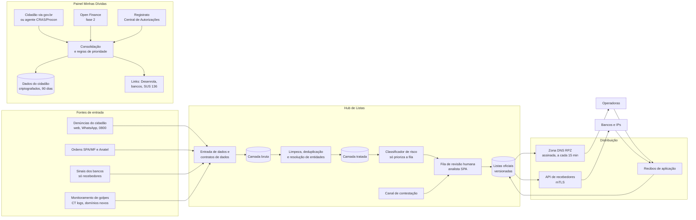
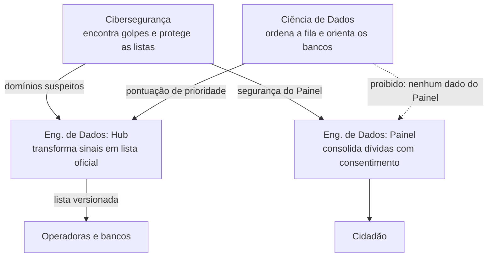

# Saída Segura: uma plataforma de dados para fechar o caminho do dinheiro das apostas ilegais e abrir o caminho de saída das dívidas

## Integrantes

| Nome completo | GitHub | Área de carreira | RGM |
|---|---|---|---|
| Valter Geronimo da Silva Junior | Valtergsj | Engenharia de Dados (Hub de Listas) | 47807458 |
| Gabriell Dos Santos Turuda Barbosa | gabriellturuda02-jpg | Engenharia de Dados (Painel de Dívidas) | 47964901 |
| Cauã Martins Aziago | cauaaziago20-creator | Engenharia de Dados (Painel de Dívidas) | 48100170 |
| Gabriel Plácido da Silva| placidogabriel788-glitch | Cibersegurança | 47770511 |

**Dossiê:** 3 — Endividamento e o fim das apostas online

**Recorte:** ex-apostadores e seus familiares com renda de até 5 salários mínimos, na **etapa pós-proibição** (a partir da MP nº 1.394/2026). A solução cobre dois momentos dessa etapa: (1) impedir que essas pessoas caiam no mercado ilegal e nos golpes que surgiram com o fim das apostas, atacando o lado de **quem recebe o dinheiro** (domínios e recebedores de Pix), e (2) dar a elas uma visão consolidada das próprias dívidas, com caminho para renegociar e para pedir ajuda em saúde mental.

*Por que este recorte:* a faixa de até 5 salários mínimos é a mesma do Novo Desenrola Brasil – Famílias (MP nº 1.355/2026), o que permite ligar a solução a um programa público que já existe. E a etapa pós-proibição é onde o problema mudou de forma: o mercado regulado acabou, mas o ilegal e os golpes cresceram. Esse é o ponto em que a Engenharia de Dados, área central do grupo, faz mais diferença, porque o gargalo hoje é **mover listas e dados entre governo, bancos e operadoras com rapidez e confiança**.

---

## 1. Análise do problema

### 1.1 Quem é afetado, onde e quanto

**As famílias estão no maior nível de endividamento já medido.** A Peic/CNC registrou 82% das famílias com dívidas a vencer em julho de 2026, cerca de 60 milhões de lares, sexto recorde consecutivo. O cartão de crédito aparece em 85,3% dos casos. Em setembro houve o primeiro recuo do ano, puxado pelas famílias de menor renda, mas o tempo médio de atraso chegou ao maior nível desde novembro de 2024. Entre as famílias com renda de até três salários mínimos, o endividamento chegou a 84,6%.

**As apostas tiraram renda das famílias em escala nacional.** Em 2025, as famílias perderam R$ 62,5 bilhões líquidos para as bets, o equivalente a 0,68% da Renda Nacional Disponível Bruta das Famílias, e as empresas de apostas movimentaram R$ 350,97 bilhões via Pix no ano. Mais de 25 milhões de pessoas apostaram em plataformas legalizadas em 2025, segundo a SPA/MF citada pelo Ministério da Saúde.

**A compulsão é um problema de saúde que cresce.** Os atendimentos na atenção primária do SUS por mania de jogos de apostas e transtorno do jogo passaram de 194 em 2018 para 5.007 em 2025; na atenção especializada, de 85 para 1.592. O teleatendimento do Meu SUS Digital, aberto em março de 2026, teve 6.912 cadastros em três meses.

**A proibição mudou o problema, mas não o eliminou.** A MP nº 1.394, de 25/09/2026, proibiu a exploração, a oferta, a intermediação e a publicidade das apostas de quota fixa, cancelou as 85 licenças do setor e tirou os sites do ar a partir de 6 de outubro. Os números da transição mostram o tamanho do que ficou para trás:

| O que | Número | Fonte |
|---|---|---|
| Saldo ainda a resgatar em 02/10/2026 | R$ 1,453 bilhão, distribuído entre 28,65 milhões de CPFs | Ministério da Fazenda (via ABCdoABC) |
| Sites encaminhados para bloqueio desde a MP (até 09/10/2026) | 16.627 | Governo federal (via Band) |
| Pedidos de bloqueio do Ministério da Fazenda desde dez/2024 | mais de 78 mil | Anatel e Senasp (via Teletime) |
| Novos sites ilegais identificados entre 22 e 28/09/2026 | 6.401 (média de 914 por dia) | ANJL (via Sigma World) |
| Queda no número de transações Pix desde a MP | 10% | Anatel e Senasp (via Teletime) |

**Os golpes passaram a explorar o próprio fim das apostas.** Surgiram páginas que imitam o portal do governo e cobram taxa via Pix para "liberar" saldo de bets, páginas falsas que coletam CPF de apostadores, embora a devolução oficial seja automática pelos bancos, e falsas casas de aposta que prometem até R$ 3 mil a partir de um Pix de R$ 20 e depois travam o saque.

**Onde.** O problema é nacional. O perfil mais atingido pelos problemas com jogo inclui pessoas negras, de baixa renda, moradoras de regiões metropolitanas e do Nordeste, segundo dados do INPAD apresentados pelo Ministério da Saúde ao Senado. Por isso o piloto (seção 6.2) prevê uma capital do Nordeste.

**Quem é afetado, em resumo:** ex-apostadores e famílias (renda, dívida, saúde mental); quem ainda aposta escondido em sites ilegais (sem nenhuma proteção); bancos e instituições de pagamento (passaram a ter obrigações e responsabilidade tributária solidária quando movimentam recursos de bets ilegais); operadoras de telecomunicações (executam os bloqueios); o governo (fiscalização, SUS, Desenrola).

### 1.2 Causas

**Causas tecnológicas (foco da proposta):**

1. **Domínio novo é mais rápido que bloqueio.** Registrar um domínio leva minutos; o fluxo atual (Fazenda identifica → Anatel ordena → cada operadora aplica) leva dias. A própria associação do setor (ANJL) apontou que novos endereços surgem minutos depois de cada derrubada. Até 29/09, só 2.387 dos 5.209 domínios pedidos já tinham ordem de bloqueio.
2. **As listas não são um produto de dados.** Os bloqueios circulam como ofícios e planilhas, sem formato padronizado, sem versionamento, sem histórico de quem incluiu o quê e por quê, e sem confirmação de que cada operadora ou banco aplicou a versão mais recente. Não há um "contrato de dados" entre quem produz a lista e quem a consome.
3. **O dinheiro passa por recebedores trocáveis.** Quase todo o fluxo das apostas foi via Pix. No mercado ilegal, o recebimento passa por contas de terceiros e intermediários que mudam com frequência. Cada banco enxerga só os próprios clientes; um recebedor bloqueado num banco reaparece em outro.
4. **Bloqueio por DNS tem limites técnicos conhecidos.** Ele é contornado por VPN, DNS alternativo (inclusive DNS sobre HTTPS no navegador) e troca constante de endereço. Bloqueio por IP derruba sites legítimos que dividem o mesmo servidor ou CDN.
5. **Golpes usam marca e urgência.** Sites falsos copiam a identidade visual do governo e das marcas extintas e são distribuídos por redes sociais e mensageiros. Certificados TLS gratuitos e hospedagem barata fazem o site parecer confiável.
6. **A dívida está espalhada em vários sistemas.** O cidadão tem cartão num banco, crédito pessoal em outro e um app de crédito numa fintech. O Registrato (SCR) mostra parte disso, mas atualiza mensalmente e exige conta gov.br prata ou ouro. O Open Finance já soma mais de 250 milhões de consentimentos, mas é usado principalmente para vender produtos, não para o cidadão enxergar o próprio quadro.
7. **Apps de crédito projetados para o "sim".** Aprovação em segundos e parcelamento sem custo efetivo total visível são decisões de produto que empurram a pessoa a contratar por impulso.

**Causas não tecnológicas:** publicidade clandestina por influenciadores; juros altos do rotativo; falta, há muitos anos, de uma rede de cuidado para quem tem compulsão; insegurança jurídica (a MP ainda precisa ser votada e é contestada no STF).

### 1.3 O que já existe e por que não basta

| Iniciativa | O que faz | Por que não basta |
|---|---|---|
| Bloqueio de sites pela Anatel a pedido da SPA/MF | Ordena às operadoras o bloqueio de domínios | Fluxo lento diante de ~900 novos sites/dia; sem padrão de dados nem confirmação de aplicação |
| Decreto de jun/2026 e Portaria MF nº 1.766/2026 | Bloqueio de recursos de bets ilegais e responsabilidade tributária solidária das instituições financeiras | Cria a obrigação, mas não a infraestrutura de dados para os bancos saberem, a tempo, quais recebedores bloquear |
| Plataforma Centralizada de Autoexclusão (dez/2025) | O apostador bloqueia o próprio acesso a sites **autorizados** | Com a proibição, não há mais sites autorizados; não alcança o mercado ilegal |
| Registrato (Banco Central) | Extrato gratuito de empréstimos e contas | Atualização mensal; não calcula prioridade nem conecta à renegociação; barreira do gov.br prata/ouro |
| Novo Desenrola Brasil – Famílias (MP nº 1.355/2026) | Descontos de até 90%, juros reduzidos e uso do FGTS para dívidas em atraso | O cidadão precisa ir a cada banco separadamente; não há visão única de quais dívidas são elegíveis |
| Teleatendimento SUS (Meu SUS Digital, telefone 136) | Cuidado em saúde mental para problemas com apostas | Pouco conhecido; não aparece no momento em que a pessoa olha as próprias dívidas |
| Devolução automática de saldos pelos bancos | Devolve o saldo das bets encerradas | Abriu espaço para golpes de "falso resgate" que não têm canal rápido de derrubada |

**O que falta e a proposta resolve:** as peças existem, mas não conversam. Falta uma **camada de dados confiável** que (a) transforme denúncias e ordens de bloqueio em listas padronizadas, versionadas e distribuídas em minutos para operadoras e bancos, e (b) junte, com consentimento, as dívidas do cidadão num só lugar e o leve até o Desenrola e até o SUS.

---

## 2. Proposta tecnológica

### 2.1 A solução, do ponto de vista do usuário

O **Saída Segura** é uma plataforma pública, contratada pela Secretaria de Prêmios e Apostas do Ministério da Fazenda (SPA/MF) e operada em nuvem de governo, com dois produtos que compartilham a mesma base de engenharia de dados:

- **Hub de Listas:** para operadoras, bancos e instituições de pagamento. Recebe denúncias, ordens de bloqueio e detecções, e publica duas listas oficiais: **domínios** de apostas ilegais e golpes, e **recebedores** (CNPJ e chaves Pix de recebimento) ligados a esses sites.
- **Painel Minhas Dívidas:** para o cidadão. Mostra todas as dívidas numa tela, em linguagem simples, indica quais pagar primeiro, quais são elegíveis ao Desenrola e oferece ajuda em saúde mental. **Não oferece crédito.**

**Jornada 1 — Dona Marta, 52 anos, filho ex-apostador, recebe mensagem de "resgate de saldo".**

1. Ela recebe pelo WhatsApp um link que promete liberar o saldo do filho em troca de uma "taxa".
2. Encaminha a mensagem para o número oficial do Saída Segura (ou acessa `saidasegura.gov.br`, ou liga no 0800). Não precisa se identificar.
3. Recebe na hora a resposta: *"Este link não é do governo. O saldo das bets é devolvido automaticamente pelo banco, sem taxa. Não pague nada."*
4. A denúncia entra no Hub. Se o domínio já é conhecido, ela é somada à evidência existente. Se é novo, vai para a fila de análise priorizada.
5. Um analista da SPA confirma. Em até 15 minutos depois da confirmação, o domínio está na lista que as operadoras aplicam e o recebedor do Pix está na lista que os bancos consultam. Quem tentar pagar a "taxa" vê no app do banco o aviso *"Recebedor associado a golpe ou aposta ilegal"*.

**Jornada 2 — Rafael, 27 anos, apostava, tem cartão no rotativo e dois empréstimos.**

1. Acessa o Painel com a conta gov.br, ou vai a um CRAS ou Procon parceiro e é atendido por um agente com o tablet do programa.
2. Escolhe como trazer as dívidas: autoriza o compartilhamento via **Open Finance** (fase 2), compartilha o relatório do **Registrato** pela Central de Autorizações do Banco Central ou digita os valores à mão.
3. Vê uma tela única: quanto deve no total, quanto paga de juros por mês em cada dívida, quais estão em atraso e quais **parecem elegíveis ao Desenrola** (renda até 5 salários mínimos, atraso entre 90 dias e dois anos, contratada até 31/01/2026).
4. O painel sugere uma ordem de prioridade com regra explicada (*"o rotativo do cartão cobra mais juros; comece por ele"*) e mostra o link oficial de renegociação de cada banco.
5. Em todas as telas há o botão **"Quero parar de apostar / preciso de ajuda"**, que leva ao telefone 136 e ao teleatendimento do Meu SUS Digital, sem registrar nada de forma identificada.
6. Rafael pode apagar tudo a qualquer momento. Sem uso, os dados são apagados automaticamente após 90 dias.

**Jornada 3 — Banco ou operadora.**

1. A operadora assina a zona DNS de bloqueio (padrão RPZ), atualizada de forma incremental a cada 15 minutos e assinada digitalmente.
2. O banco consulta a API de recebedores antes de concluir um Pix (ou carrega o arquivo incremental) e devolve ao Hub um **recibo de aplicação**: "versão 4.812 aplicada às 10h03".
3. Se o banco identificar, nos próprios dados, um recebedor suspeito, envia ao Hub só o identificador do recebedor e um resumo da evidência. **Nunca envia dados de quem pagou.**

1. A operadora assina a zona DNS de bloqueio (padrão RPZ), atualizada de forma incremental a cada 15 minutos e assinada digitalmente.
2. O banco consulta a API de recebedores antes de concluir um Pix (ou carrega o arquivo incremental) e devolve ao Hub um **recibo de aplicação**: "versão 4.812 aplicada às 10h03".
3. Se o banco identificar, nos próprios dados, um recebedor suspeito, envia ao Hub só o identificador do recebedor e um resumo da evidência. **Nunca envia dados de quem pagou.**

### 2.2 Arquitetura

**Que dados entram, onde ficam e quem acessa**

| Dado | De onde vem | Onde fica | Quem acessa |
|---|---|---|---|
| Domínios, URLs, capturas de tela, registros de certificado | Denúncias, SPA/Anatel, monitoramento | Camadas bruta e tratada do Hub (armazenamento de objetos em formato aberto, criptografado) | Equipe técnica e analistas SPA; operadoras recebem só a lista final |
| Recebedores (CNPJ, chave Pix de recebimento, instituição) | SPA/MF, sinais dos bancos, denúncias | Camada tratada e lista oficial | Analistas SPA; bancos recebem só o identificador e o motivo da inclusão |
| Texto da denúncia e contato opcional do denunciante | Cidadão | Camada bruta, separada do restante, com acesso restrito | Somente analistas SPA, com registro de acesso |
| Dívidas do cidadão | Open Finance, Registrato ou digitação | Banco transacional do Painel, criptografado por usuário | **Somente o próprio cidadão** (e o agente CRAS durante o atendimento presencial, com consentimento na tela) |
| Métricas agregadas (cliques em "preciso de ajuda", nº de painéis) | Painel | Repositório analítico, sem identificação | Gestão do programa, SPA, Ministério da Saúde |

**Separação total entre os dois produtos:** o Hub e o Painel compartilham ferramentas e equipe, mas **não compartilham bancos de dados**. Não tem como cruzar "quem tem dívida" com "quem foi denunciado". Isso é uma regra de arquitetura (contas de nuvem, chaves de criptografia e permissões separadas), não só uma política.

### 2.3 O trabalho de cada área

#### Engenharia de Dados — Hub de Listas (Valter)

É o coração da proposta: transformar uma operação manual de ofícios e planilhas num **produto de dados** com prazo, qualidade e rastreabilidade.

- **Contratos de dados:** define o esquema de cada fonte (campos obrigatórios, formato do domínio normalizado, formato de CNPJ e chave Pix, nível de evidência). Fonte que não cumpre o contrato é rejeitada com mensagem clara, em vez de contaminar a lista.
- **Ingestão (entrada dos dados):** conectores para formulário web, WhatsApp (API oficial), planilhas da SPA, ofícios da Anatel (API ou arquivo estruturado), feed de logs de Certificate Transparency e sinais dos bancos (API com mTLS).
- **Arquitetura em camadas (lakehouse):** camada bruta imutável (tudo que entrou, como entrou), camada tratada (normalizado e deduplicado), camada oficial (o que foi aprovado por humano). Tabelas em formato aberto (Apache Iceberg) sobre armazenamento de objetos, o que dá **versionamento** e consulta ao estado da lista em qualquer data ("o que estava bloqueado em 10/10 às 14h?").
- **Resolução de entidades:** liga domínio ↔ operador ↔ recebedor Pix ↔ CNPJ. Um mesmo operador ilegal pode ter centenas de domínios espelho; agrupá-los permite bloquear o grupo quando há evidência, e não um domínio por vez.
- **Orquestração:** Apache Airflow em micro-lotes de 15 minutos (escolha justificada no quadro de decisões).
- **Qualidade:** testes automáticos a cada lote (Great Expectations ou dbt tests): nenhum domínio de lista de proteção (gov.br, grandes portais de notícia e esporte, bancos) pode entrar na lista; nenhuma linha sem aprovação humana pode ir para a camada oficial; variação brusca de volume dispara alerta.
- **Linhagem (de onde veio cada dado) e auditoria:** cada item da lista oficial carrega quem incluiu, quando, com qual evidência e qual analista aprovou (OpenLineage + trilha de auditoria imutável).
- **Distribuição:** gera a zona RPZ incremental (IXFR) assinada com TSIG para operadoras e a API/arquivo incremental assinado para bancos. Recebe os **recibos de aplicação** e mede, por consumidor, o atraso entre publicação e aplicação.
- **SLAs:** publicação em até 15 minutos após aprovação; disponibilidade da API de 99,9%; remoção da lista em até 1 hora quando uma contestação for aceita.

#### Engenharia de Dados — Painel Minhas Dívidas ([Integrante 2])

- **Integração com Open Finance (fase 2):** o Painel não pode ser receptor de dados sozinho, porque só instituições autorizadas participam do ecossistema. Proposta: uma **instituição financeira pública participante atua como receptora**, sob contrato que proíbe qualquer uso comercial dos dados (sem oferta de crédito, sem modelagem para venda). Integração no padrão de segurança FAPI exigido pelo ecossistema.
- **Integração com Registrato (fase 1):** o cidadão compartilha o relatório pela Central de Autorizações do Banco Central ou faz o upload do relatório. O pipeline extrai e normaliza as operações (tipo, credor, saldo, atraso).
- **Modelo de dados canônico da dívida:** um esquema único (credor, modalidade, saldo devedor, taxa mensal, custo efetivo total quando disponível, dias de atraso, data de contratação, origem do dado e data da informação), independente de a dívida vir do Open Finance, do Registrato ou da digitação.
- **Regras de prioridade e elegibilidade:** regras fixas, públicas e versionadas (não um modelo de aprendizado de máquina): ordenar por custo mensal e marcar as dívidas que podem ser renegociadas. Como as regras são versionadas, quando o governo criar um novo programa de renegociação (como foi o Novo Desenrola, encerrado em 31/08/2026), basta publicar uma nova versão com os critérios dele, sem mudar o pipeline. O Painel sempre avisa que a decisão final é do banco.
- **Retenção e exclusão:** rotina diária que apaga dados de usuários sem acesso há 90 dias e executa pedidos de exclusão em até 24 horas, com prova (registro de exclusão sem o conteúdo).
- **Métricas agregadas:** pipeline separado que produz só contagens (painéis criados, % com dívida que pode ser renegociada, cliques em ajuda) para a gestão, sem identificação.

#### Ciência de Dados ([Integrante 3])

- **Classificador de risco de domínios:** modelo leve (gradient boosting) com sinais como idade do domínio, padrão do nome (semelhança com marcas extintas e com "gov"), emissor e data do certificado, texto e elementos da página (termos de aposta, botões de depósito Pix), hospedagem compartilhada com domínios já confirmados. **O modelo só ordena a fila de revisão humana; ele nunca bloqueia nada sozinho.**
- **Detecção de recebedores suspeitos, feita dentro de cada banco:** a consultoria entrega aos bancos um **modelo de referência** e um guia de sinais **do lado de quem recebe** (muitos pagadores distintos em pouco tempo, valores pequenos e repetidos, picos em horários de jogos, conta recém-aberta com volume alto). O banco roda o modelo nos próprios dados e envia ao Hub só o identificador do recebedor e a pontuação. O Hub nunca vê os pagadores.
- **Avaliação e viés:** mede precisão por tipo de site (para não penalizar portais legítimos de esporte, fantasy ou loterias oficiais da Caixa) e, no caso dos recebedores, mede quantos são pessoas físicas que podem ser "laranjas" ou vítimas, para que sejam encaminhadas a análise e orientação, e não a bloqueio automático.
- **Monitoramento:** acompanha a deriva do modelo, isto é, a perda de acerto com o tempo (os operadores ilegais mudam de tática), e reajusta o modelo todo mês com os rótulos dados pelos analistas.
- **O que a Ciência de Dados não faz, por decisão:** não dá nota de vulnerabilidade a ninguém, não calcula a "chance de apostar" de ninguém e não usa os dados do Painel para treinar modelo algum.

#### Cibersegurança ([Integrante 4])

- **Caça a golpes:** monitora logs de Certificate Transparency e registros de domínios novos em busca de nomes que imitam o governo, os bancos e as marcas extintas (typosquatting e troca de letras por outras parecidas, como "rn" no lugar de "m"), e pede a derrubada a registradores e provedores de hospedagem, além de incluir os domínios no Hub.
- **Integridade das listas:** a lista oficial é o ativo mais sensível do sistema. Se um atacante incluir `seubanco.com.br` na lista, derruba um banco; se remover um site ilegal, reativa o golpe. Controles: assinatura digital de cada versão, chaves em HSM, aprovação em duas pessoas para entradas de alto impacto, lista de proteção que nunca pode ser bloqueada.
- **Segurança do Painel:** login exclusivo pelo gov.br, criptografia por usuário, segredos em cofre, testes de invasão antes de cada lançamento, proteção contra extração em massa (limite de requisições).
- **Antiphishing do próprio programa:** domínio único dentro do gov.br, comunicação padronizada (*"o Saída Segura nunca pede Pix, senha ou taxa"*), monitoramento de páginas que imitem o Painel.
- **Resposta a incidentes e LGPD:** plano de resposta com comunicação à ANPD e aos titulares nos prazos da lei.

#### Como as áreas se complementam

A Cibersegurança e a Ciência de Dados **geram sinais**; a Engenharia de Dados do Hub **transforma sinais em decisão auditável e distribuída**; a Engenharia de Dados do Painel **entrega ao cidadão** um quadro que hoje está espalhado. A seta pontilhada é tão importante quanto as outras: a separação entre os produtos é parte do desenho.

### 2.4 O que a tecnologia não resolve

- **A compulsão.** O Painel aponta o caminho para o SUS, mas o tratamento depende de profissionais, da rede de atenção psicossocial e de financiamento, que a MP reduziu ao extinguir a destinação social das bets.
- **O contorno técnico do bloqueio.** VPN, DNS alternativo e aplicativos distribuídos fora das lojas continuam funcionando. O Hub reduz o alcance e o tempo de vida dos sites; não os elimina. Por isso o foco no **dinheiro** (recebedores) é complementar ao foco nos domínios.
- **Pagamentos fora do Pix.** Criptoativos e intermediários no exterior escapam das listas de recebedores nacionais e dependem de cooperação internacional e regulação de ativos virtuais.
- **A decisão política e jurídica.** A MP pode caducar (perder a validade) se não for votada, e há ações no STF. A solução foi pensada para servir também a um possível mercado regulado (sites ilegais e golpes existiriam de qualquer forma), mas a continuidade dela depende do Congresso e do Supremo.
- **Os juros.** O Painel mostra o custo; não o reduz. Taxas e regras do rotativo são política monetária e regulação do Conselho Monetário Nacional.
- **A publicidade clandestina.** Remover perfis de influenciadores depende das plataformas de redes sociais e de ação do Ministério da Justiça.
- **O atendimento humano.** Agentes de CRAS e Procon precisam ser treinados e remunerados; isso é decisão de gestão pública.

---

## 3. Análise ética

### 3.1 Matriz de riscos

| # | Risco | Classificação | Impacto (quem e quão grave) | Controle |
|---|---|---|---|---|
| 1 | O Hub virar instrumento de **vigilância das transações de toda a população** ("quem pagou Pix para onde") | Legal/privacidade | Toda a população com conta bancária. **Muito grave**: quebra de sigilo bancário, medo de usar o Pix, uso dos dados para outro fim | Arquitetura só aceita **identificadores de recebedores**; contrato de dados rejeita campos de pagador; auditoria externa a cada seis meses do esquema e dos registros de entrada de dados |
| 2 | **Bloqueio indevido** de site legítimo (portal de esportes, loja que divide servidor, loteria oficial) | Governança | Empresas e leitores afetados. **Alto**: prejuízo econômico e restrição de acesso à informação | Bloqueio só por domínio, nunca por IP; lista de proteção; revisão humana obrigatória; contestação com resposta em até 48h e remoção em 1h se o pedido for aceito |
| 3 | **Pessoa física "laranja"** ou vítima marcada como recebedora de aposta ilegal | Viés/inclusão | Pessoas vulneráveis que cederam a conta, muitas de baixa renda. **Alto**: bloqueio de conta, perda de renda, estigma | Recebedor pessoa física nunca entra em bloqueio automático; vai para análise do banco com orientação e possibilidade de defesa; não gera negativação |
| 4 | Dados do Painel usados para **oferecer crédito predatório** | Ético | Endividados, justamente o público vulnerável. **Muito grave**: piora o problema que a solução quer resolver | Contrato com a instituição receptora proíbe uso comercial; Painel sem anúncios nem ofertas; dados não saem do Painel; auditoria de acesso; métricas de sucesso não premiam contratação de crédito |
| 5 | **Vazamento** dos dados financeiros do Painel | Segurança | Usuários do Painel. **Muito grave**: dado íntimo, risco de golpe direcionado ("sei que você deve ao banco X") | Criptografia por usuário, retenção de 90 dias, teste de invasão, cofre de segredos, plano de resposta a incidentes |
| 6 | **Alteração indevida da lista oficial** por atacante ou por uso político (bloquear adversários) | Segurança / governança | Toda a internet brasileira. **Muito grave** | Assinatura digital por versão, aprovação em duas pessoas para alto impacto, trilha de auditoria imutável, publicação do motivo de cada inclusão em relatório de transparência |
| 7 | Classificador com **viés** contra sites em português de esportes ou de pequenas empresas | Viés/inclusão | Pequenos negócios legítimos. **Médio** (reduzido pela revisão humana) | Teste de viés por categoria antes de cada versão; o modelo só prioriza a fila |
| 8 | **Exclusão** de quem não tem gov.br prata/ouro, smartphone ou letramento digital | Viés/inclusão | Idosos, pessoas de baixa escolaridade e sem internet. **Alto**: justamente parte do público-alvo | Atendimento presencial em CRAS e Procon, canal telefônico, digitação manual de dívidas (ver seção 4) |
| 9 | Golpistas **imitarem o próprio Saída Segura** | Segurança | Usuários e denunciantes. **Alto** | Domínio único dentro do gov.br; regra pública "nunca pedimos Pix, senha ou taxa"; monitoramento de imitações |

### 3.2 Decisão

**Implantar com controles.**

O problema é grave e atual: ~900 sites ilegais novos por dia, golpes que exploram a devolução de saldos e famílias no maior nível de endividamento da série. Não agir também tem custo ético. Os riscos graves (1, 4, 5 e 6) são reais, mas podem ser controlados **por arquitetura** (o Hub não recebe dados de pagadores; o Painel não compartilha banco de dados com o Hub; a lista é assinada) e não apenas por promessa. Os riscos de exclusão e de erro (2, 3, 7 e 8) exigem revisão humana e canais alternativos, que entram como pré-requisito. A implantação começa por um piloto em dois estados (seção 6.2), com auditoria externa antes de ampliar. Se a auditoria encontrar entrada de dados de pagadores ou uso comercial do Painel, o produto correspondente é suspenso.

### 3.3 Controles antes de entrar em produção

| Eixo | Controle | Quem faz | Como saber que foi cumprido |
|---|---|---|---|
| Transparência | Relatório público mensal: nº de domínios e recebedores incluídos e removidos, motivos por categoria, contestações e tempo de resposta. Página explicando, em linguagem simples, o que o Painel faz e o que não faz com os dados | Engenharia de Dados (Hub) + Gestão SPA | Relatório publicado até o dia 10 de cada mês; página aprovada em teste de compreensão com 20 usuários (≥ 80% entendem que o Painel não oferece crédito) |
| Revisão humana | Nenhum item entra na lista oficial sem aprovação de analista da SPA; inclusões de alto impacto (domínios com mais de N acessos, recebedor pessoa física) exigem duas aprovações | Analistas SPA; regra implementada pela Engenharia de Dados | Teste automático que falha o lote se houver item sem aprovação; auditoria trimestral em amostra de 200 itens |
| Minimização de dados | Contrato de dados do Hub sem nenhum campo de pagador; Painel com retenção de 90 dias e exclusão a pedido do usuário em 24h; métricas só agregadas | Engenharia de Dados (Hub e Painel) | Revisão do esquema por auditoria externa; relatório de exclusões executadas; teste que tenta enviar campo de pagador e confirma rejeição |
| Segurança | Assinatura digital das listas com chaves em HSM; mTLS para bancos; criptografia por usuário no Painel; teste de invasão independente antes do lançamento | Cibersegurança | Laudo de teste de invasão sem vulnerabilidade crítica ou alta em aberto; verificação de assinatura obrigatória documentada por todas as operadoras do piloto |
| Teste de viés | Avaliação do classificador por categoria de site (esporte, notícia, loteria oficial, pequeno comércio) e da proporção de recebedores pessoa física sinalizados por região | Ciência de Dados | Taxa de falso positivo de nenhuma categoria acima de 2× a média; relatório de viés anexado a cada nova versão do modelo |
| Canal de contestação | Formulário e telefone para donos de sites e titulares de contas contestarem inclusões; resposta em até 48h; remoção em 1h se o pedido for aceito; ouvidoria independente da equipe técnica | Gestão SPA + Ouvidoria do MF; fluxo implementado pela Engenharia de Dados | Painel interno com prazo de cada contestação; ≥ 95% respondidas em até 48h; relatório incluído na transparência mensal |

### 3.4 LGPD

| Dado pessoal | Finalidade | Base legal | Por quanto tempo | Sensível ou de criança/adolescente? |
|---|---|---|---|---|
| Nome e CPF do usuário do Painel (via gov.br) | Autenticar e vincular os dados ao titular | Consentimento (art. 7º, I) | Enquanto a conta existir; apagado 90 dias após o último acesso | Não |
| Dívidas do usuário (credor, valor, taxa, atraso) | Mostrar ao próprio titular a visão consolidada e as opções de renegociação | Consentimento (art. 7º, I), exigido também pelas regras do Open Finance | 90 dias após o último acesso ou até a revogação, o que vier primeiro | Não é sensível pela LGPD, mas tratado como **altamente confidencial** |
| Renda declarada (opcional) | Verificar se a pessoa se encaixa em programas públicos de renegociação, quando houver | Consentimento (art. 7º, I) | Mesmo prazo das dívidas | Não |
| Contato opcional do denunciante | Responder ao denunciante, se ele quiser | Consentimento (art. 7º, I) | 12 meses | Não |
| CPF e chave Pix de recebedor pessoa física | Prevenir pagamentos a apostas ilegais e golpes | Cumprimento de obrigação legal (art. 7º, II, MP nº 1.394/2026) e execução de políticas públicas (art. 7º, III) | Enquanto estiver na lista + 5 anos para auditoria e defesa | Não; atenção especial ao risco de "laranjas" (risco 3) |
| Dados de registro de domínios (quando pessoa física) | Identificar operadores e grupos de sites | Execução de políticas públicas (art. 7º, III) | Enquanto o domínio estiver na lista + 5 anos | Não |
| Registros de acesso ao Painel | Segurança e investigação de incidentes | Obrigação legal (Marco Civil da Internet, art. 15) | 6 meses | Não |
| Clique em "preciso de ajuda" | Medir o uso do encaminhamento ao SUS | **Não é tratado como dado pessoal**: registrado só como contagem agregada, sem identificação | Contagem agregada mantida sem prazo | Seria **dado sensível de saúde** (art. 11) se identificado; por isso não é |

**Crianças e adolescentes:** o Painel é restrito a maiores de 18 anos (verificação pelo gov.br). Denúncias de menores apostando em sites ilegais são aceitas, mas o sistema não pede nem armazena dados do menor, só o domínio do site.

### 3.5 Comunicado público

> A [Consultoria] desenvolveu o Saída Segura com a Secretaria de Prêmios e Apostas. Ele faz duas coisas: distribui a bancos e operadoras, em minutos, a lista de sites de apostas ilegais, golpes e recebedores de Pix ligados a eles; e mostra ao cidadão, com consentimento, todas as suas dívidas em um só lugar, com caminho para renegociar e para pedir ajuda ao SUS. Não monitoramos quem paga, não vendemos crédito e todo bloqueio passa por revisão humana e pode ser contestado. Bloqueio não acaba com VPN nem trata a compulsão: isso exige cuidado e política pública.

**Contagem:** 562 caracteres (com espaços)

---

## 4. Acessibilidade e inclusão digital

### 4.1 Quem pode ficar de fora

| Grupo | Barreira | O que a solução faz |
|---|---|---|
| Pessoas sem smartphone ou sem internet | Não acessam o Painel nem o formulário de denúncia | Denúncia por telefone (0800) e por SMS; atendimento presencial em CRAS e Procon parceiros, com agente que usa o tablet do programa e imprime o resumo das dívidas |
| Pessoas sem conta gov.br prata/ouro | O Registrato e o login do Painel exigem esse nível | Modo presencial: o agente ajuda a subir o nível da conta (validação bancária ou biometria) ou o cidadão digita as dívidas manualmente sem login, numa sessão que não salva nada |
| Pessoas idosas | Telas complexas, letras pequenas, medo de golpe | Interface com poucas opções por tela, texto grande ajustável, botão "falar com uma pessoa", e a mensagem fixa "nunca pedimos Pix, senha ou taxa" |
| Pessoas com baixa escolaridade | Termos como "rotativo", "custo efetivo total", "consentimento" | Linguagem simples, exemplos em reais ("esta dívida custa R$ 87 por mês de juros"), versão em áudio de cada tela e vídeos curtos com legenda e Libras |
| Pessoas cegas ou com baixa visão | Gráficos e botões sem descrição | Compatibilidade com leitores de tela, tabela textual equivalente a cada gráfico, contraste alto |
| Pessoas surdas | Atendimento telefônico | Atendimento por chat e WhatsApp; vídeos em Libras; VLibras nas páginas |
| Pessoas com deficiência motora | Interações que exigem precisão | Navegação completa por teclado, alvos de toque grandes, sem tempo limite nas telas |
| Pessoas em sofrimento (compulsão, vergonha) | Medo de exposição impede a busca por ajuda | Denúncia anônima; botão de ajuda sem registro identificado; nenhum julgamento no texto ("muita gente passou por isso") |
| Familiares que cuidam do apostador | Não são titulares dos dados | Uso da Central de Autorizações do Banco Central (o titular compartilha com até cinco pessoas); familiar pode denunciar sites e golpes sem precisar dos dados do titular |

### 4.2 Requisitos de acessibilidade

Os requisitos seguem a **WCAG 2.2, nível AA**, e a Lei Brasileira de Inclusão. Cada requisito tem um critério de aceite testável.

| # | Requisito | Critério WCAG 2.2 | Como testar |
|---|---|---|---|
| A1 | Toda imagem e todo gráfico têm texto alternativo; gráficos de dívidas têm tabela equivalente | 1.1.1 Conteúdo não textual (A) | Auditoria com leitor de tela (NVDA e TalkBack) |
| A2 | Contraste mínimo de 4,5:1 para texto e 3:1 para componentes de interface | 1.4.3 Contraste mínimo (AA); 1.4.11 Contraste não textual (AA) | Ferramenta automática + checagem manual |
| A3 | Página funciona com zoom de 200% e em tela de 320 px de largura sem rolagem horizontal | 1.4.4 Redimensionar texto (AA); 1.4.10 Reflow (AA) | Teste em celular simples (tela pequena) |
| A4 | Todas as funções acessíveis por teclado, com foco visível e nunca escondido por elementos fixos | 2.1.1 Teclado (A); 2.4.7 Foco visível (AA); 2.4.11 Foco não obscurecido (AA) | Percorrer a jornada completa só com teclado |
| A5 | Alvos de toque com pelo menos 24×24 px (meta interna: 44×44 px) | 2.5.8 Tamanho do alvo – mínimo (AA) | Inspeção do layout |
| A6 | Nenhuma tela com tempo limite; sessões longas avisam antes de expirar e permitem estender | 2.2.1 Tempo ajustável (A) | Teste com usuário que leva 10 minutos numa tela |
| A7 | Login sem teste cognitivo (sem quebra-cabeça ou memorização), aceitando gerenciador de senhas e o fluxo do gov.br | 3.3.8 Autenticação acessível – mínimo (AA) | Revisão do fluxo de login |
| A8 | Erros de formulário identificados em texto, com sugestão de correção ("o valor deve ter só números") | 3.3.1 Identificação de erro (A); 3.3.3 Sugestão de erro (AA) | Teste de formulário com entradas inválidas |
| A9 | Não pedir de novo um dado que o usuário já informou na mesma jornada | 3.3.7 Entrada redundante (A) | Revisão da jornada de cadastro de dívidas |
| A10 | Ajuda (telefone, chat, "falar com uma pessoa") sempre no mesmo lugar em todas as telas | 3.2.6 Ajuda consistente (A) | Revisão de todas as telas |
| A11 | Componentes com nome, função e estado expostos para tecnologias assistivas | 4.1.2 Nome, função, valor (A) | Auditoria com leitor de tela |
| A12 | Textos em linguagem simples, com meta de nível de leitura de ensino fundamental | 3.1.5 Nível de leitura (AAA, adotado como meta) | Índice de legibilidade + teste com usuários de baixa escolaridade |

**Critério de lançamento:** zero falhas nos critérios A e AA na auditoria, e teste de usabilidade com pelo menos 30 pessoas, incluindo idosos, pessoas com deficiência visual e pessoas com baixa escolaridade, com taxa de conclusão da jornada principal de pelo menos 80%.

---

## 5. Sustentabilidade

### 5.1 Impacto ambiental da solução

**De onde vem o consumo:** processamento dos micro-lotes do Hub, armazenamento das camadas de dados, servidores da API e do Painel, treino mensal do classificador e o tráfego das listas para centenas de operadoras e bancos.

**Escolhas para reduzi-lo:**

- **Micro-lotes de 15 minutos em vez de streaming contínuo.** Um cluster de streaming fica ligado 24 horas por dia; micro-lotes usam recursos só durante o processamento. 15 minutos atendem ao objetivo (o gargalo atual é de dias, não de segundos).
- **Distribuição incremental.** Operadoras e bancos recebem só o que mudou desde a última versão (IXFR no DNS, arquivo diferencial na API), e não a lista inteira a cada ciclo, o que reduz tráfego e processamento nos dois lados.
- **Modelo pequeno em vez de modelo de linguagem grande.** O classificador de domínios é um gradient boosting que treina em minutos numa CPU comum. Um LLM para classificar cada página consumiria muito mais energia sem ganho proporcional para uma tarefa de priorização.
- **Retenção curta e camadas de armazenamento.** Os dados do Painel são apagados em 90 dias; capturas de tela antigas do Hub vão para armazenamento frio após 6 meses e são apagadas após o prazo de auditoria.
- **Ajuste automático de capacidade.** Os servidores do Painel diminuem de madrugada, quando o uso é baixo.
- **Infraestrutura existente.** A operação usa a nuvem de governo já contratada (Serpro ou Dataprev), sem compra de servidores novos. Os tablets para CRAS e Procon vêm de equipamentos já existentes nesses órgãos ou de doações de equipamentos reformados, com descarte por programa de logística reversa certificado.
- **Medição.** Painel mensal de consumo de energia e emissões estimadas, com meta de redução de 10% por usuário ativo no segundo ano.

### 5.2 Sustentabilidade do projeto

- **Quem mantém:** no primeiro ano, a consultoria constrói e opera junto com uma equipe da SPA/MF e da empresa pública de tecnologia (Serpro ou Dataprev). A partir do mês 9 começa a transferência de conhecimento; no mês 13, a operação passa toda para a equipe pública, com a consultoria em suporte por mais 6 meses.
- **Quem paga:** orçamento da SPA/MF. Como a MP extinguiu as receitas de destinação social das bets, a proposta sugere ao governo usar parte do dinheiro das multas aplicadas a operadores ilegais e a instituições que descumpram as listas (a MP prevê multa de até R$ 2 bilhões por infração). A integração das listas é obrigação legal dos bancos e operadoras, que pagam o próprio custo de uso.
- **Depois do primeiro ano:**
  - O código do Hub e do Painel é publicado como **software público**, permitindo auditoria e reaproveitamento (por exemplo, por estados e Procons).
  - Um **comitê de governança** (SPA/MF, Banco Central, Anatel, Ministério da Saúde, Procon, representante da sociedade civil) revisa a cada seis meses as regras de inclusão e o relatório de transparência.
  - Se a MP não for convertida em lei, o Hub continua útil contra **golpes financeiros** e contra operadores sem autorização em um possível mercado regulado; o Painel continua útil para qualquer família endividada. O desenho não depende da proibição para fazer sentido.

---

## 6. Impacto esperado

### 6.1 Indicadores

| Indicador | Como medir | Meta | Prazo |
|---|---|---|---|
| Tempo entre a primeira denúncia de um domínio e sua presença na lista aplicada pelas operadoras | Data da denúncia (Hub) até o recibo de aplicação (operadoras) | Mediana < 24h (hoje: dias) | 6 meses após o piloto |
| Cobertura das listas | % de assinantes de banda larga atendidos por operadoras que enviam recibo; % das transações Pix feitas em instituições integradas | ≥ 90% dos assinantes; ≥ 85% das transações Pix | 12 meses |
| Atraso de aplicação pelos consumidores | Diferença entre publicação e recibo de aplicação | ≥ 95% das versões aplicadas em até 30 minutos | 6 meses |
| Tempo de vida de sites de golpe que imitam o governo | Detecção até derrubada ou bloqueio | Mediana < 48h | 6 meses |
| Erros de bloqueio | Contestações aceitas / total de inclusões | < 2% | Contínuo |
| Prazo de contestação | % respondidas em até 48h | ≥ 95% | Contínuo |
| Uso do Painel pelo público-alvo | Painéis criados por pessoas com renda até 5 salários mínimos | 300 mil no piloto; 2 milhões em 12 meses | 12 meses |
| Renegociação | % de usuários com dívida marcada como renegociável que declaram ter renegociado em 90 dias (pergunta opcional no Painel) | ≥ 25% | 12 meses |
| Encaminhamento para cuidado | Cliques em "preciso de ajuda" e variação dos cadastros no teleatendimento do SUS nas regiões do piloto (dado agregado do MS) | Crescimento de 20% nos cadastros nas regiões do piloto | 12 meses |
| Acessibilidade | Falhas WCAG A/AA em auditoria trimestral; % de atendimentos presenciais e telefônicos | Zero falhas; ≥ 15% dos atendimentos fora do app | Contínuo |
| Privacidade | Auditoria externa sem encontrar dado de pagador no Hub ou uso comercial do Painel | Nenhum problema encontrado | Semestral |

**O que, de propósito, não é meta:** "número de pessoas identificadas como apostadoras" ou "quantidade de crédito contratado". Indicadores assim premiariam vigilância ou endividamento.

### 6.2 Como os usuários serão ouvidos

- **Antes de construir (meses 1 e 2):** entrevistas com 40 pessoas: ex-apostadores e familiares atendidos em CAPS e no Ambulatório do Jogo (com apoio dos profissionais de saúde), usuários de Procon e CRAS, e equipes técnicas de 3 operadoras regionais e 5 bancos e fintechs.
- **Protótipo (mês 3):** testes de usabilidade do Painel com 30 pessoas, incluindo idosos, pessoas com deficiência visual e pessoas de baixa escolaridade; teste da integração do Hub com 2 operadoras e 2 bancos em ambiente de homologação.
- **Piloto (meses 4 a 9):** dois estados, São Paulo e Pernambuco, escolhidos por combinarem uma grande metrópole do Sudeste e uma capital do Nordeste, região que aparece com destaque no perfil de pessoas com problemas com jogo. Pesquisa curta e opcional ao final de cada uso do Painel; grupo consultivo de usuários com reunião mensal; canal aberto para operadoras e bancos relatarem problemas técnicos.
- **Critério para ampliar (mês 10):** só se as metas de erro de bloqueio, contestação, acessibilidade e privacidade forem cumpridas e a auditoria externa não encontrar problemas graves.

### 6.3 Se a solução não pegar

| Risco de não pegar | Sinal | O que fazer |
|---|---|---|
| Operadoras pequenas não integram a zona RPZ | Recibos de aplicação ausentes de provedores regionais (o Brasil tem milhares de provedores pequenos) | Oferecer servidor DNS recursivo público com a lista já aplicada e um guia de configuração de 1 página; apoiar via associações de provedores; Anatel cobra pela obrigação |
| Bancos não usam a lista de recebedores ou usam tarde | Atraso de aplicação acima da meta | Relatório com o nome de cada instituição para o Banco Central e a SPA; lembrar da responsabilidade tributária solidária |
| Público não confia no Painel ("é golpe") | Baixa adesão, muitas desistências no login | Divulgação pelos canais oficiais e pelo app do banco do próprio cidadão; atendimento presencial; apoio de Procons e da rede de saúde |
| O Painel é usado, mas ninguém renegocia | Muitos painéis, pouca renegociação declarada | Entrevistar usuários; testar ligação direta com o canal de renegociação dos principais bancos |
| Operadores ilegais migram para criptoativos ou aplicativos | Queda de Pix nas listas, sem queda nas denúncias | Levar evidências ao Banco Central e à Polícia Federal; incluir no Hub endereços de carteira quando houver base legal |
| A MP caduca ou o STF a suspende | Decisão do Congresso ou do Supremo | Reposicionar o Hub para golpes financeiros e operadores sem autorização; o Painel segue sem mudanças |

---

## 7. Quadro de decisões

| Decisão | Alternativas consideradas | Por que escolhemos esta |
|---|---|---|
| **Listar recebedores e domínios, e não monitorar pagadores** | (a) Monitorar as transações Pix de todos para achar apostadores; (b) não usar dados de pagamento | (a) seria vigilância em massa e quebra de sigilo, além de punir quem já é vítima; (b) ignoraria o ponto em que o mercado ilegal é mais frágil, o recebimento. Focar em quem recebe ataca o dinheiro sem olhar para a população |
| **Bloqueio por DNS (RPZ) por domínio, distribuído como lista incremental assinada** | (a) Bloqueio por IP; (b) inspeção profunda de pacotes (DPI); (c) manter ofícios e planilhas | (a) derruba sites legítimos que dividem servidor ou CDN; (b) é cara, invasiva e inspeciona o tráfego de todos; (c) é lenta e sem rastreabilidade. RPZ é um padrão aberto, já aceito pelos servidores DNS das operadoras, e permite atualização incremental |
| **Micro-lotes de 15 minutos** | (a) Streaming em tempo real; (b) lote diário | (a) custa e consome mais energia, e o gargalo real é a revisão humana, não os segundos; (b) deixaria golpes no ar por um dia. 15 minutos equilibram rapidez, custo e consumo |
| **Revisão humana obrigatória antes de qualquer bloqueio** | Bloqueio automático pelo classificador | Erros de bloqueio afetam liberdade de informação e empresas legítimas; a decisão precisa ter um responsável identificável. O modelo só prioriza a fila |
| **Modelo próprio simples (gradient boosting) para priorizar domínios** | (a) LLM pronto de mercado; (b) só regras fixas | (a) mais caro, mais consumo de energia, difícil de explicar e de auditar; (b) operadores ilegais aprendem as regras rápido. Um modelo pequeno é explicável, barato e fácil de reajustar todo mês |
| **Painel começa com Registrato e digitação; Open Finance entra na fase 2 via instituição pública receptora** | (a) Open Finance desde o início; (b) pedir senhas dos bancos (screen scraping); (c) só digitação | (a) exige contrato com instituição participante e homologação, o que atrasaria o piloto; (b) é inseguro e incompatível com as regras do ecossistema; (c) é trabalhosa e sujeita a erro. Começar com o Registrato entrega valor rápido e o Open Finance amplia depois |
| **Regras fixas e públicas para prioridade e elegibilidade de dívidas, sem modelo de vulnerabilidade** | Modelo de aprendizado de máquina que estima "risco de superendividamento" | Uma nota de vulnerabilidade é exatamente o que pode ser usado para vender crédito predatório. Regras públicas ("pague primeiro o juro mais caro") são explicáveis e suficientes |
| **Hub e Painel com bancos de dados, contas e chaves separados** | Uma base única para os dois produtos | Uma base única tornaria possível cruzar "quem deve" com "quem foi denunciado". A separação física impede esse uso, mesmo com mudança de gestão |
| **Nuvem de governo (Serpro/Dataprev) com formatos abertos (Iceberg)** | (a) Grande nuvem comercial (AWS, Azure, Google Cloud) contratada direto; (b) servidores próprios da SPA | (a) levanta questões de soberania e dependência de fornecedor; (b) exigiria comprar hardware e equipe de data center. A nuvem de governo já existe e já é contratada; formatos abertos evitam ficar preso a um fornecedor |
| **Web acessível + WhatsApp + telefone + presencial, sem aplicativo nativo próprio** | Aplicativo próprio para Android e iOS | Um app novo exige instalação, ocupa memória de celulares simples e vira alvo de imitação. Canais que a população já usa alcançam mais gente com menos custo |

## 8. Capítulos individuais

Somos alunos do primeiro ano de Análise e Desenvolvimento de Sistemas (ADS). Cada um escolheu a área de carreira em que quer se especializar e ficou com a parte da proposta ligada a ela. Por isso, nos planos abaixo, a maioria das competências técnicas aparece como "Não" ou "Parcial": a proposta mostra o que um profissional dessas áreas faria, e as metas mostram o caminho que cada um de nós precisa seguir para chegar lá.

### 8.1 [Nome do Integrante 1] — Engenharia de Dados (Hub de Listas)

**Papel no projeto:** pesquisou como funciona hoje o bloqueio de sites de apostas (os pedidos da Fazenda, as ordens da Anatel e o volume de sites novos por dia) e, a partir disso, montou a ideia do Hub de Listas: de onde vêm os dados, como eles são limpos e aprovados e como chegam às operadoras e aos bancos. Escreveu as seções 1.2 (causas tecnológicas), 2.2 (arquitetura e diagrama em Mermaid), 2.3 (Engenharia de Dados – Hub) e as decisões sobre bloqueio por DNS, micro-lotes e nuvem no quadro de decisões (seção 7). Também escreveu os controles de transparência e de minimização de dados da seção 3.3.

**Plano de desenvolvimento**

| Competência que a solução exige | Técnica ou comportamental | Já tenho? |
|---|---|---|
| Lógica de programação | Técnica | Parcial (vista no primeiro semestre) |
| Python básico (variáveis, listas, funções, leitura de arquivos) | Técnica | Não |
| SQL (consultas, filtros, junções entre tabelas) | Técnica | Não |
| Modelagem de dados (tabelas, chaves, relacionamentos) | Técnica | Não |
| Noções de pipeline de dados (extrair, tratar e carregar) | Técnica | Não |
| Noções de redes e DNS (o que é um domínio e como o bloqueio funciona) | Técnica | Não |
| Git e GitHub | Técnica | Parcial (aprendeu neste trabalho) |
| Organização e cumprimento de prazos | Comportamental | Parcial |
| Explicar uma ideia técnica para quem não é da área | Comportamental | Parcial |

**Metas SMART (6 a 12 meses)**

1. Até **fevereiro de 2027**, concluir o curso gratuito de Python do Curso em Vídeo (Mundo 1) e publicar no GitHub pelo menos 10 exercícios resolvidos.
2. Até **abril de 2027**, terminar um curso introdutório de SQL (por exemplo, o SQLBolt ou o curso de banco de dados da Fundação Bradesco) e criar um banco simples, com pelo menos 3 tabelas relacionadas, sobre um tema do dia a dia (por exemplo, controle de gastos).
3. Até **julho de 2027**, fazer um mini pipeline em Python que leia um arquivo CSV público (por exemplo, do portal dados.gov.br), limpe os dados e grave o resultado num banco SQLite, com o código e um README no GitHub.
4. Até **novembro de 2027**, fazer a trilha gratuita de fundamentos de dados do Microsoft Learn e prestar a prova da certificação Microsoft DP-900 (Azure Data Fundamentals).

**Feedback dos colegas**

[Revisar em grupo:] Foi quem mais pesquisou sobre como o bloqueio de sites funciona na prática, e o diagrama ajudou todo mundo a entender a proposta. Como sugestão, achamos que vale treinar a explicação do diagrama em voz alta antes da arguição, porque é a parte que o professor mais deve perguntar. Também sugerimos começar pelo SQL antes de partir para ferramentas maiores, já que quase tudo em Engenharia de Dados depende dele.

### 8.2 [Nome do Integrante 2] — Engenharia de Dados (Painel Minhas Dívidas)

**Papel no projeto:** pesquisou os dados de endividamento das famílias (Peic/CNC), o Registrato, o Open Finance e o Novo Desenrola, e descobriu que o programa tinha perdido a validade em agosto de 2026, o que mudou o desenho do Painel. Montou as jornadas do usuário (Dona Marta e Rafael) e a ideia de juntar as dívidas da pessoa numa só tela. Escreveu as seções 1.1 (quem é afetado), 1.3 (o que já existe), 2.1 (a solução do ponto de vista do usuário), 2.3 (Engenharia de Dados – Painel) e a tabela de LGPD (seção 3.4).

**Plano de desenvolvimento**

| Competência que a solução exige | Técnica ou comportamental | Já tenho? |
|---|---|---|
| Lógica de programação | Técnica | Parcial (vista no primeiro semestre) |
| Python básico | Técnica | Não |
| SQL e banco de dados relacional | Técnica | Não |
| Noções de API (o que é, como um sistema conversa com outro) | Técnica | Não |
| Conhecimento básico da LGPD | Técnica | Parcial (estudou para este trabalho) |
| Noções de Open Finance e de como os bancos compartilham dados | Técnica | Parcial (estudou para este trabalho) |
| Empatia e escuta com pessoas em situação difícil | Comportamental | Sim |
| Escrita clara e em linguagem simples | Comportamental | Parcial |

**Metas SMART (6 a 12 meses)**

1. Até **fevereiro de 2027**, concluir o curso gratuito de LGPD da Escola Virtual de Governo (EV.G) e guardar o certificado no portfólio.
2. Até **abril de 2027**, concluir o curso de Python do Curso em Vídeo (Mundo 1) e publicar no GitHub um programa simples que leia uma lista de dívidas digitada pelo usuário e mostre o total e a dívida com o maior juro.
3. Até **julho de 2027**, terminar um curso introdutório de SQL e refazer o mesmo programa guardando as dívidas num banco SQLite.
4. Até **novembro de 2027**, aprender o básico de APIs com um conteúdo gratuito (por exemplo, os módulos sobre APIs do Microsoft Learn) e fazer o programa buscar algum dado de uma API pública, como a cotação do dólar no Banco Central.

**Feedback dos colegas**

[Revisar em grupo:] Trouxe o olhar de quem vai usar o sistema, e as jornadas deixaram a proposta mais humana e fácil de entender. Ter encontrado a informação de que o Desenrola acabou salvou o trabalho de um erro sério. Como sugestão, achamos que vale estudar um pouco mais como o Open Finance funciona por dentro, porque é uma pergunta provável na arguição, e manter o hábito de sempre conferir se a informação ainda vale na data de hoje.

### 8.3 [Nome do Integrante 3] — Ciência de Dados

**Papel no projeto:** pesquisou como identificar sites e contas de apostas ilegais sem vigiar a população e defendeu duas decisões importantes da proposta: o modelo só organiza a fila para um analista humano revisar (nunca bloqueia sozinho), e o sistema não dá "nota de vulnerabilidade" para ninguém, para que os dados não sejam usados para vender crédito. Escreveu a seção 2.3 (Ciência de Dados), os riscos 3 e 7 da matriz, o controle de teste de viés (seção 3.3) e a tabela de indicadores (seção 6.1).

**Plano de desenvolvimento**

| Competência que a solução exige | Técnica ou comportamental | Já tenho? |
|---|---|---|
| Lógica de programação | Técnica | Parcial (vista no primeiro semestre) |
| Python básico | Técnica | Não |
| Estatística básica (média, mediana, porcentagem, gráficos) | Técnica | Parcial (vista no ensino médio) |
| Análise de dados com planilhas | Técnica | Parcial |
| Análise de dados com Python (pandas) | Técnica | Não |
| Noções de aprendizado de máquina (o que é um modelo de classificação) | Técnica | Não |
| Entender o que é viés em dados e por que ele importa | Técnica | Parcial (estudou para este trabalho) |
| Senso ético ao lidar com dados de pessoas | Comportamental | Sim |
| Trabalho em equipe | Comportamental | Parcial |

**Metas SMART (6 a 12 meses)**

1. Até **fevereiro de 2027**, concluir o curso gratuito de Python do Kaggle Learn e publicar o certificado no LinkedIn.
2. Até **abril de 2027**, concluir o curso de pandas do Kaggle Learn e fazer uma análise simples de um conjunto de dados público brasileiro (por exemplo, da Peic/CNC ou do dados.gov.br), com pelo menos 3 gráficos e conclusões escritas, publicada num notebook no Kaggle ou no GitHub.
3. Até **agosto de 2027**, concluir o curso "Intro to Machine Learning" do Kaggle Learn e treinar um primeiro modelo de classificação com um conjunto de dados de exemplo, explicando no README o que o modelo acerta e o que erra.
4. Até **novembro de 2027**, participar de pelo menos uma competição para iniciantes no Kaggle (por exemplo, a do Titanic) e escrever um texto curto, no LinkedIn ou no GitHub, sobre o que aprendeu.

**Feedback dos colegas**

[Revisar em grupo:] Foi firme nas decisões éticas, e isso deixou a análise ética do trabalho mais forte e coerente. Como sugestão, achamos que vale treinar a explicação de por que o banco analisa só quem recebe o Pix e não quem paga, porque é o ponto mais delicado da proposta. Também sugerimos começar pelo Python e pela análise de dados antes de partir para modelos, para ter uma base sólida.

### 8.4 [Nome do Integrante 4] — Cibersegurança

**Papel no projeto:** pesquisou os golpes que surgiram com o fim das apostas (falso resgate de saldo, sites que imitam o governo e falsas casas de aposta) e mostrou ao grupo que a própria lista de bloqueio também é um alvo: se alguém mudar a lista, pode derrubar um site legítimo ou liberar um golpe. Escreveu a seção 2.3 (Cibersegurança), a seção 2.4 (o que a tecnologia não resolve), os riscos 5, 6 e 9 da matriz, o controle de segurança (seção 3.3) e as seções 4 (acessibilidade) e 5 (sustentabilidade).

**Plano de desenvolvimento**

| Competência que a solução exige | Técnica ou comportamental | Já tenho? |
|---|---|---|
| Lógica de programação | Técnica | Parcial (vista no primeiro semestre) |
| Fundamentos de redes (IP, DNS, o que é um domínio) | Técnica | Não |
| Fundamentos de segurança da informação (confidencialidade, integridade, disponibilidade) | Técnica | Parcial (estudou para este trabalho) |
| Reconhecer golpes e sites falsos (phishing) | Técnica | Parcial |
| Noções de criptografia e senhas seguras | Técnica | Não |
| Linux básico (terminal) | Técnica | Não |
| Noções de acessibilidade digital (WCAG) | Técnica | Parcial (estudou para este trabalho) |
| Atenção a detalhes | Comportamental | Sim |
| Calma e clareza para explicar riscos | Comportamental | Parcial |

**Metas SMART (6 a 12 meses)**

1. Até **fevereiro de 2027**, concluir o curso gratuito "Introdução à Cibersegurança" da Cisco Networking Academy (Skills for All) e guardar o certificado.
2. Até **abril de 2027**, concluir o curso gratuito "Fundamentos de Redes" da Cisco Networking Academy e montar, no GitHub, um resumo com 10 conceitos aprendidos (por exemplo, o que é DNS e como funciona um bloqueio de site).
3. Até **julho de 2027**, completar a trilha introdutória gratuita do TryHackMe ("Pre Security") e o básico de terminal Linux, registrando o progresso no perfil da plataforma.
4. Até **novembro de 2027**, estudar o conteúdo gratuito e prestar a prova da certificação ISC2 Certified in Cybersecurity (CC), voltada para quem está começando na área.

**Feedback dos colegas**

>Trouxe para o grupo a preocupação com golpes e com a segurança da própria solução, algo em que ninguém tinha pensado no começo. Também assumiu as seções de acessibilidade e sustentabilidade com cuidado. Como sugestão, achamos que vale estudar os fundamentos de redes logo no começo, porque eles ajudam a entender quase tudo em segurança, e anotar as fontes de cada informação enquanto pesquisa, para facilitar na hora de montar as referências.

---

## 9. Referências

> Todas as fontes abaixo foram publicadas a partir de novembro de 2024, exceto leis e normas.

- NSC Total. *Endividamento das famílias bate o sexto recorde consecutivo e atinge 82% dos lares em julho*. 2026. https://www.nsctotal.com.br/economia/endividamento-familias-recorde-julho-2026-brasil
- Fenacon. *CNC: inadimplência e endividamento das famílias brasileiras recuam em setembro*. 2026. https://fenacon.org.br/noticias/cnc-inadimplencia-e-endividamento-das-familias-brasileiras-recuam-em-setembro/
- BP Money. *Endividamento das famílias bate recorde pela quinta vez consecutiva*. 2026. https://bpmoney.com.br/?p=404589
- BP Money. *Famílias perdem R$ 62,5 bilhões para bets em 2025, aponta boletim fiscal*. 2026. https://bpmoney.com.br/economia/familias-perdem-62-bilhoes-bets-2025-boletim-fiscal/
- Ministério da Saúde (Marcelo Kimati Dias, DESMAD/SAES). *Jogos de apostas: impactos na saúde mental e as respostas do SUS*. Apresentação ao Senado Federal, 2026. https://legis.senado.leg.br/sdleg-getter/documento/download/2ad6e89b-5712-41c7-9ecb-22078ecc951b
- Brasil de Fato / Agência Brasil. *Alta demanda faz SUS ampliar teleatendimento a jogadores compulsivos*. 20 jun. 2026. https://www.brasildefato.com.br/2026/06/20/alta-demanda-faz-sus-ampliar-teleatendimento-a-jogadores-compulsivos/
- Presidência da República. *Medida Provisória nº 1.394, de 25 de setembro de 2026* (texto publicado). https://static.poder360.com.br/uploads/2026/10/MP-1.394-de-2026.pdf — Registro no Senado: https://legis.senado.leg.br/norma/44059160
- Senado Federal, Consultoria Legislativa. *Sumário Executivo da Medida Provisória nº 1.394, de 2026*. 2026. https://www12.senado.leg.br/publicacoes/estudos-legislativos/tipos-de-estudos/sumarios-de-proposicoes/mpv1394
- Central do Varejo. *MP das Bets proíbe apostas online no Brasil e prevê bloqueio por operadoras a partir de 6 de outubro*. Set. 2026. https://centraldovarejo.com.br/?p=46280
- Demarest Advogados. *Governo Federal proíbe apostas de quota fixa no Brasil*. 28 set. 2026. https://www.demarest.com.br/?p=169934
- ABCdoABC. *Resgate do saldo de apostadores em bets cai 31%*. Out. 2026. https://abcdoabc.com.br/resgate-saldo-apostadores-em-bets-cai-31
- Band. *Governo bloqueia 16 mil sites ilegais de apostas e identifica 20 mil perfis*. 9 out. 2026. https://www.band.com.br/nacional/brasil/governo-bloqueia-16-mil-sites-ilegais-de-apostas-e-identifica-20-mil-perfis
- Teletime. *Governo apresenta balanço da retirada das bets do ar*. 30 set. 2026. https://teletime.com.br/30/09/2026/governo-retirada-bets-do-ar/
- Sigma World. *Mais de 6 mil sites ilegais surgem em uma semana no Brasil*. Set. 2026. https://sigma.world/pt-br/news/sites-ilegais-apostas-mais-de-6-mil-surgem/
- SBT News. *Golpe virtual simula portal Gov para reembolso das bets*. 22 out. 2026. https://sbtnews.sbt.com.br/noticia/economia/golpe-virtual-simula-portal-gov-para-reembolso-das-bets
- Poder360. *Golpe usa site falso do governo para captar CPF de apostadores*. Out. 2026. https://www.poder360.com.br/poder-brasil/golpe-usa-site-falso-do-governo-para-captar-cpf-de-apostadores/
- TNH1. *Falsas bets prometem até R$ 3.000 com Pix de R$ 20 e bloqueiam saque*. 7 out. 2026. https://www.tnh1.com.br/noticia/nid/falsas-bets-prometem-ate-r-3000-com-pix-de-r-20-e-bloqueiam-saque/
- Convergência Digital. *Bets: Anatel bloqueou 50 mil sites de apostas ilegais* (decreto de bloqueio de recursos e Portaria MF nº 1.766/2026). Jun. 2026. https://convergenciadigital.com.br/?p=52946
- Congresso em Foco. *Governo pede bloqueio de 5.209 sites de bets após proibição no Brasil*. 30 set. 2026. https://www.congressoemfoco.com.br/noticia/122732/governo-pede-bloqueio-de-5-209-sites-de-bets-apos-proibicao-no-brasil
- Mercado & Consumo. *Ferramenta do BC supera 100 milhões de relatórios de dados financeiros*. 24 fev. 2026. https://mercadoeconsumo.com.br/24/02/2026/economia/ferramenta-do-bc-supera-100-milhoes-de-relatorios-de-dados-financeiros/
- Barbieri Advogados. *Registrato do Banco Central: guia completo sobre SCR, prejuízo e direitos do consumidor*. 27 nov. 2025. https://www.barbieriadvogados.com/?p=1012
- Let's Money. *Open Finance: consentimentos ativos* (série semanal do Banco Central). 2026. https://www.letsmoney.com.br/dados/of-consentimentos-ativos/ — ver também Zetta. *Open Finance no Brasil: cinco anos de transformação*. 2026. https://static.poder360.com.br/uploads/2026/09/Zetta_2026_Open-Finance-no-Brasil_Final-1-1.pdf
- iGaming Business Brasil. *ANJL e IBJR pedem ao STF suspensão da Medida Provisória que proibiu as bets no Brasil*. Set. 2026. https://igamingbusiness.com/br/juridico-conformidade/anjl-e-ibjr-pedem-ao-stf-suspensao-da-mp-que-proibiu-as-bets-no-brasil/
- Paraíba Business. *STF discute risco regulatório e efeitos econômicos da proibição das bets*. 3 nov. 2026. https://paraibabusiness.com.br/stf-discute-risco-regulatorio-e-efeitos-economicos-da-proibicao-das-bets/
- Futuro da Saúde. *Cresce demanda no SUS por tratamento de dependência em jogos e apostas*. 2026. https://futurodasaude.com.br/cresce-demanda-sus-tratamento-dependencia-bets/
- Presidência da República. *Medida Provisória nº 1.355, de 4 de maio de 2026* (Novo Desenrola Brasil). https://www.planalto.gov.br/ccivil_03/_ato2023-2026/2026/mpv/mpv1355.htm
- Congresso em Foco. *Sem votação no Congresso, cinco medidas provisórias perdem a validade*. 8 set. 2026. https://www.congressoemfoco.com.br/noticia/122030/sem-votacao-no-congresso-cinco-medidas-provisorias-perdem-a-validade
- Brasil 61. *Novo Desenrola Brasil: saiba como renegociar dívidas com FGTS e descontos de até 90%*. Mai. 2026. https://brasil61.com/n/novo-desenrola-brasil-saiba-como-renegociar-dividas-com-fgts-e-descontos-de-ate-90-bras2616362 — ver também COAD. *Novo Desenrola vai usar até R$ 8,2 bi do FGTS para quitar dívidas*. https://www.coad.com.br/home/noticias-detalhe/137301/novo-desenrola-vai-usar-ate-r-82-bi-do-fgts-para-quitar-dividas
- Legismap / Banco Central. *Registrato chega a noventa milhões de relatórios emitidos* (Central de Autorizações). 9 set. 2025. https://legismap.com.br/conteudos/artigos-e-noticias/bc-registrato-chega-a-noventa-milhoes-de-relatorios-emitidos
- Poder360. *Governo chama vício em bets de problema de saúde, mas corta verbas*. Set. 2026. https://www.poder360.com.br/opiniao/governo-chama-vicio-em-bets-de-problema-de-saude-mas-corta-verbas/
- W3C. *Web Content Accessibility Guidelines (WCAG) 2.2*. Recomendação vigente. https://www.w3.org/TR/WCAG22/
- Brasil. *Lei nº 13.146, de 6 de julho de 2015* (Lei Brasileira de Inclusão). Versão vigente. https://www.planalto.gov.br/ccivil_03/_ato2015-2018/2015/lei/l13146.htm
- Garrastazu Advogados. *A proibição das bets já vale?* 2026. https://garrastazu.adv.br/a-proibicao-das-bets-ja-vale
- Brasil. *Lei nº 13.709, de 14 de agosto de 2018* (Lei Geral de Proteção de Dados Pessoais). Versão vigente. https://www.planalto.gov.br/ccivil_03/_ato2015-2018/2018/lei/l13709.htm
- Brasil. *Lei nº 12.965, de 23 de abril de 2014* (Marco Civil da Internet). Versão vigente. https://www.planalto.gov.br/ccivil_03/_ato2011-2014/2014/lei/l12965.htm
